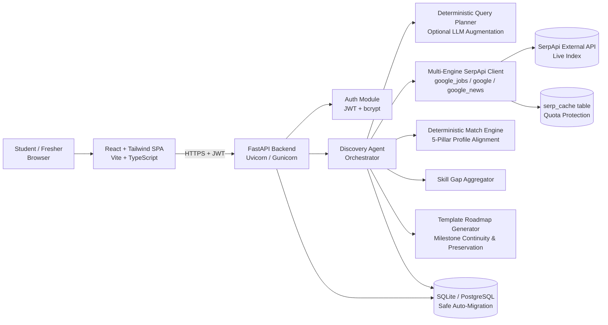
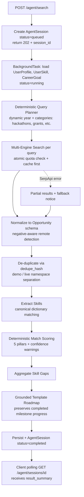

# OpportunityOS — AI Career & Opportunity Agent

> **Discover opportunities. Understand the gap. Take the next step.**

[](https://fastapi.tiangolo.com)
[](https://react.dev)
[](https://www.typescriptlang.org)
[](https://www.python.org)
[](https://tailwindcss.com)
[](LICENSE)

OpportunityOS is an AI-powered career opportunity platform for students and freshers. You describe your education, skills, target role, location, experience level, career goal, and preferred opportunity type. An AI Career Agent searches **live** opportunities through **SerpApi** (Google Jobs, Google Search, Google News; YouTube optional), scores each one against your profile with a **transparent match percentage**, identifies your missing skills, and builds a personalized learning roadmap with concrete next actions.

---

## Documentation package

| # | File | What it covers |
|---|------|----------------|
| 1 | `planing/OpportunityOS_PRD.md` | Product requirements: problem, users, features with acceptance criteria, MVP / Phase 2 / Future |
| 2 | `planing/OpportunityOS_TRD.md` | Technical requirements: architecture, agent design, SerpApi, workflows, security, deployment |
| 3 | `planing/OpportunityOS_App_Web_Flow.md` | Every screen, route, API call, and loading/empty/error state |
| 4 | `planing/OpportunityOS_UI_UX_Specification.md` | Design system and text wireframes |
| 5 | `planing/OpportunityOS_Backend_Schema_API.md` | Database schema (16 tables + DDL) and full API reference |
| 6 | `planing/OpportunityOS_Implementation_Plan.md` | Implementation plan, Git strategy, testing, deployment and checklists |

---

## Problem

Students and freshers cannot efficiently find relevant opportunities or understand why they do or do not qualify. Listings are scattered, descriptions are inconsistent, and advice like "learn more skills" does not say **which** skill, **in what order**, for **which** real opening.

## Solution

One agent run replaces manual multi-site searching:

1. Understands the user's career goal
2. Creates intelligent search queries
3. Searches through SerpApi
4. Collects and normalizes results
5. Removes duplicates
6. Matches opportunities with the user's profile
7. Calculates a transparent match percentage
8. Identifies missing skills
9. Generates a personalized learning roadmap
10. Recommends the user's next actions

```text
Frontend Developer Internship          (illustrative output format)
Ahmedabad / Remote

Match: 87%

Skills Match:
✓ HTML
✓ CSS
✓ JavaScript
✗ React
✗ REST API

Recommended Action:
Learn React → Build project → Learn REST API → Apply
```

## Features

| Feature | Status |
|---|---|
| Email/password auth (JWT) | MVP |
| 4-step onboarding: profile, career goal, skills, location & preferences | MVP |
| AI Career Agent with live stage progress | MVP |
| Live search: Google Jobs, Google Search, Google News (via SerpApi) | MVP |
| Normalization + de-duplication | MVP |
| Deterministic, explainable match score | MVP |
| Skill gap analysis (demand across top matches) | MVP |
| Personalized roadmap (learn → build → apply) | MVP |
| Dashboard, saved opportunities, application tracker, search history | MVP |
| YouTube learning resources on roadmap steps | Phase 2 |
| Resume upload, alerts, OAuth, Kanban drag-and-drop | Phase 2 |
| Placement-cell analytics, regional languages, career graph | Future |

## Architecture



- **Frontend:** React 18 SPA built with Vite, TypeScript, and Tailwind CSS.
- **Backend:** FastAPI on Python 3.11 with SQLite/PostgreSQL support.
- **Agent Lifecycle:** Asynchronous background workflow polling session status with timeout recovery and atomic quota accounting.
- **Query Planning:** Fast deterministic query generator deriving search tokens dynamically from target role, location, and selected opportunity types (hackathons, grants, fellowships, internships, etc.), with optional LLM augmentation when configured.
- **Scoring Engine:** Deterministic 5-pillar mathematical profile alignment (Skills 50%, Role 15%, Location 15%, Experience 10%, Type 10%) — 100% explainable and reproducible.
- **Roadmap Generation:** Structured Learn → Build → Apply roadmap template grounded in actual extracted skill gaps and matched opportunities, preserving completed milestone progress across repeat scans.
- **Database:** SQLite (default development) and PostgreSQL, using safe schema migrations (`migrate_database`) to support category constraints and metadata columns.

## Tech stack

| Layer | Technology |
|---|---|
| Frontend | React.js, TypeScript, Tailwind CSS, Vite, React Router |
| Backend | Python 3.11, FastAPI, SQLAlchemy 2.0, Pydantic v2 |
| AI / Search | Deterministic query planning, multi-engine SerpApi client, template roadmaps |
| Search | SerpApi — `google_jobs`, `google`, `google_news`, optional `youtube` |
| Database | SQLite & PostgreSQL (auto-migrated) |
| Auth | JWT (HS256) + bcrypt |
| Deployment | Vercel / Netlify (frontend), Render / Fly.io / Docker (backend) |

## SerpApi usage

| Engine | Purpose | Results key |
|---|---|---|
| `google_jobs` | Primary opportunities (title, company, location, via, description, highlights, apply options) | `jobs_results` |
| `google` | Career pages, hackathons, grant programs, fellowships | `organic_results` |
| `google_news` | Hiring trends shown as "market signals" (never as applyable opportunities) | `news_results` |
| `youtube` *(Phase 2)* | Tutorials for roadmap steps (`search_query` param) | `video_results` |

- Endpoint: `GET https://serpapi.com/search.json` with `engine`, `q`, `location`, `gl=in`, `hl=en`, `api_key`.
- Responses cached in `serp_cache` (default 12 h TTL) and shared across users; per-user and daily budgets protect quota.
- **No fabricated listings.** Tests and demo warm-up use real responses captured from SerpApi, cleanly namespaced (`demo:`) to prevent collision with live listings.

## AI Agent workflow



**Match formula**

```text
match_score = round(100 × (
    0.50 × skill_score        # weighted coverage of opportunity skills
  + 0.15 × role_score         # title similarity to target role
  + 0.15 × location_score     # city match / remote acceptance
  + 0.10 × experience_score   # fresher/intern signals vs user level
  + 0.10 × type_score         # internship / full-time / etc. preference
))

skill_score = Σ(weight of matched skills) / Σ(weight of all opportunity skills)
              weight: required = 1.0, preferred = 0.5
              if opportunity has 0 extracted skills → skill_score = 0.5 and
              the card shows "Skills not listed — score is less reliable"
```

## Team roles

| Member | Role | Responsibilities |
|---|---|---|
| M1 | Frontend Developer | React, Tailwind, UI, dashboard, responsive design |
| M2 | Backend Developer | FastAPI, REST APIs, authentication, business logic |
| M3 | AI + SerpApi Developer | AI Career Agent, prompts, SerpApi, query generation, matching, skill gap, roadmap |
| M4 | Database + Integration + QA | PostgreSQL, schema, integration, testing, deployment, documentation |

## Local setup

**Prerequisites:** Git, Node.js 20 LTS, Python 3.11, SQLite 3 or PostgreSQL 15+ (local Docker or cloud), and optional SerpApi key (demo simulation mode operates without an API key).

```bash
git clone <repo-url> opportunityos && cd opportunityos

# Optional PostgreSQL database (or use default local SQLite: sqlite:///./opportunityos.db)
docker run --name oos-pg -e POSTGRES_PASSWORD=postgres -e POSTGRES_DB=opportunityos -p 5432:5432 -d postgres:16

# Backend
cd backend
python -m venv .venv && source .venv/bin/activate   # Windows: .venv\Scripts\activate
pip install -r requirements.txt
cp .env.example .env                                # fill in keys (or use defaults)
# Database tables initialize automatically on app startup via SQLAlchemy Base.metadata.create_all()
python -m seeds.load_skills                         # or python -m seeds.seed_demo for demo user

# Frontend (new terminal)
cd frontend
npm install
cp .env.example .env
```

## Environment variables

```bash
# backend/.env
APP_ENV=development
API_PREFIX=
DATABASE_URL=sqlite:///./opportunityos.db
JWT_SECRET=opportunityos-super-secret-jwt-key-2026-hackathon-secure-32bytes
JWT_EXPIRE_MINUTES=60
CORS_ORIGINS=http://localhost:5173,http://localhost:3000,http://127.0.0.1:5173
SERPAPI_API_KEY=
SERPAPI_TIMEOUT_SECONDS=20
SERP_CACHE_TTL_HOURS=12
SERP_DAILY_BUDGET=80
ENABLE_YOUTUBE=false
AGENT_MAX_QUERIES=6
AGENT_TIMEOUT_SECONDS=60
GAP_TOP_N=15
LOG_LEVEL=INFO

# frontend/.env
VITE_API_BASE_URL=http://localhost:8000
```

## Run commands

| Task | Command | Notes |
|---|---|---|
| Backend dev server | `cd backend && uvicorn app.main:app --reload --port 8000` | Uses `backend/opportunityos.db` when run from `backend/` |
| Backend tests | `cd backend && pytest -v` | Run tests against an isolated test database |
| Seed skills catalog | `cd backend && python -m seeds.load_skills` | Seeds 250+ canonical skills from `skills.csv` |
| Seed demo scenario | `cd backend && python -m seeds.seed_demo` | Creates demo student (Mitva Satani) & runs agent |
| Frontend dev server | `cd frontend && npm run dev` | Available at http://localhost:5173 |
| Frontend build | `cd frontend && npm run build` | Runs TypeScript typecheck (`tsc`) + Vite production bundle |
| Production backend | `gunicorn -k uvicorn.workers.UvicornWorker app.main:app -b 0.0.0.0:$PORT` | Deployed backend entrypoint |
| API docs | http://localhost:8000/docs | Interactive OpenAPI documentation |

## API overview

| Method | Path | Auth | Purpose |
|---|---|---|---|
| POST | `/auth/register` | Public | Create account, return JWT |
| POST | `/auth/login` | Public | Authenticate, return JWT |
| GET | `/profile` | JWT | Get profile, skills and career goal |
| PUT | `/profile` | JWT | Create/update profile, skills and career goal |
| GET | `/skills` | JWT | Search the skill catalog (autocomplete) |
| POST | `/agent/search` | JWT | Run the AI Career Agent end-to-end |
| GET | `/agent/sessions/{id}` | JWT | Fetch a past or running agent session |
| GET | `/opportunities` | JWT | List matched opportunities (filters, sort, pagination) |
| GET | `/opportunities/{id}` | JWT | Opportunity detail + match explanation |
| POST | `/opportunities/{id}/save` | JWT | Save opportunity |
| DELETE | `/opportunities/{id}/save` | JWT | Unsave opportunity |
| GET | `/skill-gap` | JWT | Aggregated missing skills for latest session |
| GET | `/roadmap` | JWT | Personalized roadmap for latest session |
| PATCH | `/roadmap/steps/{id}` | JWT | Mark a roadmap step done / not done |
| GET | `/applications` | JWT | List tracked applications |
| POST | `/applications` | JWT | Start tracking an application |
| PUT | `/applications/{id}` | JWT | Update application status / notes |
| GET | `/search/history` | JWT | List previous agent searches and queries |

Errors use one envelope: `{"error": {"code", "message", "details", "request_id"}}`. Full contracts in the Backend Schema & API document.

## Folder structure

```text
opportunityos/
├── frontend/
│   └── src/ (api, auth, components, features, pages, hooks, lib)
├── backend/
│   ├── app/ (main.py, config.py, db.py, models, schemas, api/routes,
│   │         services, agent, search, matching, core)
│   ├── alembic/
│   ├── seeds/skills.csv
│   └── tests/ (fixtures/serpapi = real captured responses)
├── docs/ (this package)
├── postman/
├── scripts/
└── README.md
```

## Demo flow

1. Landing page → log in as the demo student (Final-year B.Tech, HTML/CSS/JavaScript, Ahmedabad, Frontend Developer internship, open to remote).
2. Click **Find my opportunities** → narrate agent stages (planning → searching → matching → gap → roadmap).
3. Dashboard → best match, skill gap bars, next steps, market signals.
4. Open an opportunity → "Why this score?" breakdown adds up; ✓/✗ skills; open original source.
5. Roadmap → learn → build → apply; mark a step done.
6. Save and track an application.
7. Close on architecture + explainability.

> Warm the cache with a real run 30–60 minutes before judging, keep the backend awake, and keep a recorded backup video.

## Future scope

- Continuous monitoring and alerts for new high-match openings
- Resume parsing and tailoring suggestions
- Placement-cell dashboard with batch-level skill gaps
- Hackathons, scholarships, fellowships as first-class opportunity types
- Regional language UI; mobile PWA
- Career graph linking skills, roles, employers, and learning resources
